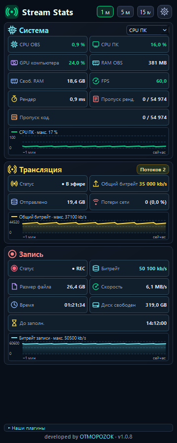
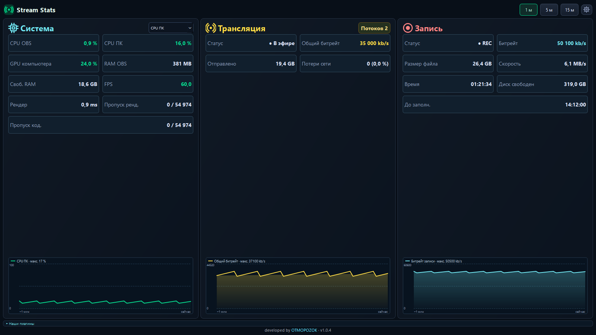

# Stream Stats

**Нагрузка компьютера, трансляция и запись в одной панели OBS.** Панель работает вертикально и горизонтально, в том числе в компактном размере стандартной статистики OBS.

[English](docs/README_EN.md)

| Вертикально | Горизонтально |
| --- | --- |
|  |  |

[Компактный вид](docs/screenshots/compact.png) · [Узкий вид](docs/screenshots/narrow.png) · [Наши плагины](docs/screenshots/plugins-expanded.png)

## Что показывает

- **Система:** загрузка процессора и видеокарты, память OBS, FPS и пропущенные кадры.
- **Трансляция:** число активных потоков, общий битрейт, объём отправки и сетевые потери.
- **Запись:** скорость и размер записи, время работы и свободное место на диске.
- **Наши плагины:** откройте свёрнутую секцию под основными блоками, чтобы увидеть измеренный CPU и учтённые данные Chat, Notify и Stats. Для Chat и Notify также показаны связь со Stats, отправленный и полученный трафик и общая сумма за запуск OBS. Объём автоматически отображается в КБ, МБ или ГБ. Сетевой трафик не включает видеопоток и не означает обмен между плагинами.

Показатель CPU учитывает измеренные участки работы каждого плагина, а не всю нагрузку OBS. «Данные» — учтённые буферы и история, а не полная память процесса OBS. Пока измерений недостаточно, CPU показан прочерком; в спокойном состоянии он может быть меньше 0,01 %.

Графики можно переключать между последними 1, 5 и 15 минутами. Панель обновляется раз в секунду и не отправляет сетевых запросов.

На графиках процентов шкала фиксирована от 0 до 100, а подпись «макс.» показывает наибольшее измеренное значение за выбранный период. Наведите курсор, чтобы увидеть значение в точке и минимум, среднее и максимум. GPU относится ко всему компьютеру.

В настройках доступны предупреждения: потери более 1% кадров за последние 10 секунд и нехватка места для записи, сохраняющаяся 30 секунд. Порог диска — меньше 5 ГБ или меньше 15 минут до заполнения. Статистика записи раскрывается при запуске REC; настройка «Сворачивать статистику записи после остановки» по умолчанию включена. Там же открывается сводка текущего сеанса с сохранением CSV; сводка предыдущего запуска сохраняется после штатного закрытия OBS.

## Как установить

1. Полностью закройте OBS. Скачайте **StreamStats-1.0.7-OBS33-Windows-x64** на странице [последней успешной сборки](https://github.com/DIMI0007/stream-stats/actions/workflows/build-windows.yml) и распакуйте ZIP.
2. Откройте `C:\ProgramData\obs-studio\plugins\`. Удалите старую папку `stream-stats`, если она есть. Скопируйте сюда папку `stream-stats` из ZIP целиком.
3. Запустите OBS и откройте **Док-панели → Stream Stats**.

Файл `stream-stats.dll` должен лежать прямо в папке `stream-stats`. [Подробная инструкция](INSTALL_RU.md).

Для **OBS Studio 33 на Windows x64**. Сборка пока не подписана. Примеры на скриншотах созданы в тестовой среде; работа с реальными устройствами проверяется в OBS.

[Общий стиль трёх плагинов](docs/VISUAL_STYLE_RU.md) · [Лицензия GPL v2 или новее](LICENSE_NOTICE.md) · [Разработчик OTMOPOZOK](https://www.youtube.com/channel/UCTAKYR3T2Ud8zZgNShgQfyw/)
## Поддержать проект

Если плагины полезны вам, поддержите проект донатом. Ваша помощь поддерживает развитие плагинов, исправления и будущую разработку.

[Поддержать через DonationAlerts](https://www.donationalerts.com/r/otmopozok) · [Поддержать через DonatePay](https://donatepay.ru/don/OTMOPOZOK)
